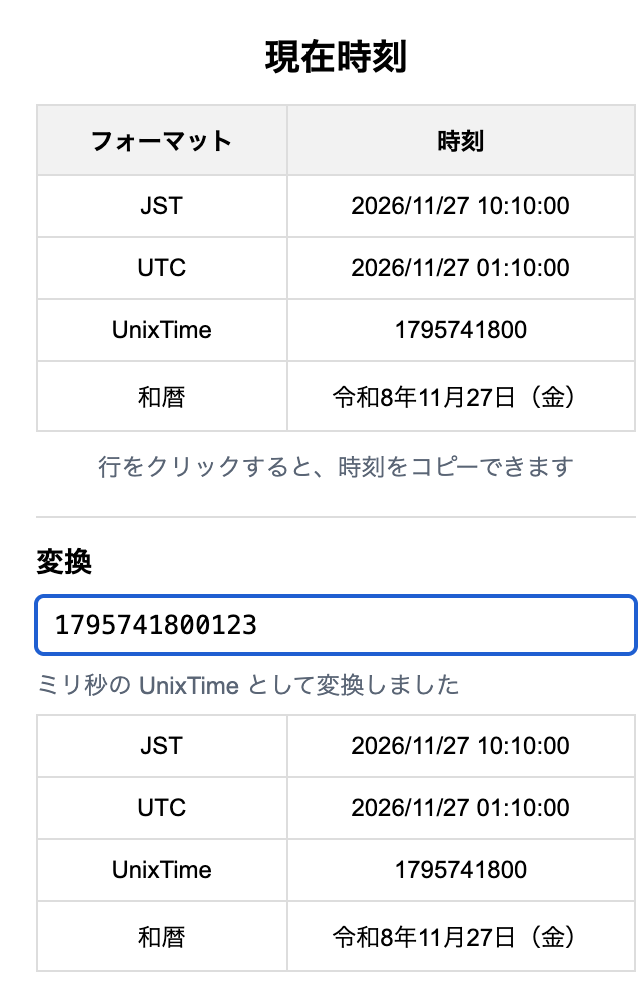

# What Time Is It Now?

## 概要

What Time Is It Now?（wtiin）は、現在時刻を表示するためのChrome拡張機能です。  
ブラウザツールバーの本拡張機能アイコンをクリックするだけで現在時刻がポップアップで表示されます。

この拡張機能では、以下の4種類の形式で現在時刻を表示します。

- **日本標準時 (JST):** 日本の現地時間で表示します。
- **世界標準時 (UTC):** 協定世界時で表示します。
- **UnixTime:** 1970年1月1日 0時 (UTC) からの経過秒数で表示します。
- **和暦:** 日本時間で数えた元号と年（例: 令和8年）を表示します。

表のそれぞれの行をクリックする（または Enter / Space キーを押す）と、その値をクリップボードにコピーできます。

### 変換

ポップアップ下部の入力欄に UnixTime や日時を入力すると、同じ4つの形式に変換して表示します。変換結果の行もクリックでコピーできます。

| 入力の例 | 扱い |
|---|---|
| `1795741800` | 秒の UnixTime |
| `1795741800123` | ミリ秒の UnixTime（13桁以上） |
| `2026-11-27 10:10` / `2026/11/27 10:10:00` | タイムゾーンの指定がないため、日本時間として扱う |
| `2026-11-27T01:10:00Z` / `2026-11-27T10:10:00+09:00` | 指定されたタイムゾーンで扱う |

## 開発環境

開発に必要なツール（Node.js 24 / just / zip / ImageMagick）は [Nix](https://nixos.org/) で管理しています。ホストに個別にインストールする必要はありません。

### 前提

- Nix（flakes 有効）
- [direnv](https://direnv.net/) + [nix-direnv](https://github.com/nix-community/nix-direnv)（任意・推奨）

### 使い方

direnv を使う場合は、初回のみ `direnv allow` を実行すると、以降はディレクトリに入るだけで環境が有効になります。direnv を使わない場合は `nix develop` でシェルに入ります。

ツールを追加・変更する場合は `flake.nix` の `packages` を編集してください。

### タスク

よく使う操作は [just](https://github.com/casey/just) のレシピにまとめています。`just` だけを実行すると一覧が表示されます。

| コマンド | 内容 |
|---|---|
| `just setup` | 依存のインストール（Playwright 用の Chromium も取得） |
| `just build` | 配布ファイルを `dist/extension/` にコピー |
| `just test` | ビルドしてテストを実行 |
| `just package` | ストア提出用の ZIP を `dist/` に作成 |
| `just screenshots` | ストア用スクリーンショット（1280x800）を `store/` に、README 用のポップアップ画像を `images/popup.png` に作成 |
| `just icons` | `images/icon-source*.svg` から拡張機能のアイコンを再生成 |
| `just clean` | 生成物を削除 |

### Chrome への読み込み

1. `just build` を実行します。
2. [chrome://extensions/](chrome://extensions/) で「デベロッパーモード」を有効にします。
3. 「パッケージ化されていない拡張機能を読み込む」から `dist/extension/` を選択します。

リポジトリのディレクトリをそのまま読み込むと、`.direnv/` なども拡張機能の一部として扱われ、不要なファイルについての警告が出ます。コードを変更したら `just build` を実行し、拡張機能を再読み込みしてください。

## スクリーンショット

## クレジット

アイコン（`images/icon-source*.svg` と、そこから生成した `icons/*.png`）はこのリポジトリのために作成したものです。

## ライセンス

このプロジェクトは MIT ライセンスの下で提供されています。  
詳細については [LICENSE](LICENSE) ファイルをご確認ください。

## 貢献

このプロジェクトへの貢献を大歓迎します！  
ご意見や改善案、バグ報告、機能追加の提案など、どんな貢献も歓迎しています。  
貢献を希望される場合は、以下の手順に従ってください。

1. **Issue の作成**  
   まずは Issue を作成し、変更内容や提案内容についてディスカッションしてください。

2. **プルリクエストの提出**  
   修正や機能追加が完了したら、プルリクエストを提出してください。  
   コードの可読性やテストの追加、ドキュメントの更新を心がけていただけると助かります。

皆様のご協力をお待ちしております！
